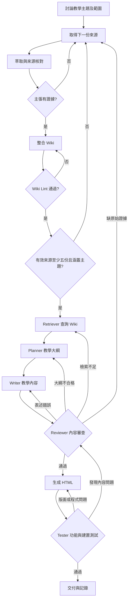

# AGENTS.md — 原神角色圖鑑與 LLM Wiki 教學簡報開發規範

版本：v2.0（延伸教學 HTML 簡報與可驗證 Workflow）

> 本檔案是本專案的**唯一權威 Agent 規則**。其他指引如有衝突，以此檔案為準。
> 適用於 ChatGPT、Codex、Claude Code 等能讀取專案檔案的 Agent。
> 在開始任何修改前，**必須先讀完本檔案**，並檢查目標資料夾的現況。
> 本版保留原角色圖鑑規範（第 0–8 節），第 9–16 節新增第二次作業的流程。既有網站應維持可用；未建立的路徑與工具須依任務再實作，不能假設已存在。
> 使用者要求先討論時，只提出計畫、範圍與驗收方式，不直接生成內容或修改網站；確認後才進入實作。若使用者只要求其中一項工作，不自動執行全部流程。

## 0. 目標及驗收

這是一個繁體中文、非官方的《原神》角色介紹 Wiki，重視世界觀、角色設定、國家與人物關聯；不是最新傷害排行或配裝網站。

**主要目標**：把 Karpathy 的 LLM Wiki 模式改造成可持續擴充、可由同一份 Markdown 自動生成網頁的角色圖鑑，並能從 Wiki 產生可追溯來源的教學 HTML 簡報。

每次 Agent 加入或修改角色時，必須符合：
1. 同一角色的事實只維護在 `wiki/characters/<slug>.md` 一處，不能手動複製一份到 HTML/JSON。
2. 使用既有 Astro 版型，角色列表與詳情頁自動生成；不得為每名角色另寫 HTML。
3. 每項新事實能追溯到具體來源；不確定的內容寫「待查證」，絕不編造。
4. 不產生失效的站內連結；角色關係如設為雙向，雙方均需更新。
5. 執行檢查，記錄本次變動；保證 GitHub Pages 部署所需路徑一致。

## 1. 四個層次＋一份治理文件

| 層次 | 位置 | 說明 | AI 權限 |
| --- | --- | --- | --- |
| 原始來源（Raw） | `raw/sources/` | 授權範圍內的資料、人工整理的來源清單與來源紀錄；留存出處 | **原始內容不可覆寫、刪除或改寫**；可新增檔案、可新增來源紀錄 |
| 知識層（Wiki） | `wiki/characters/`, `wiki/regions/`, `wiki/concepts/`, `wiki/sources/` | 角色資料、世界觀、關聯；以 Markdown 為單一事實來源 | AI 可以在遵守本規範下新增/更新 |
| 呈現層（Site） | `src/`, `public/` | Astro 網頁、模板、搜尋篩選、樣式、圖片 | AI 可修改，但必須沿用共用元件與設計系統 |
| 發佈層（Deploy） | `.github/workflows/`, `astro.config.mjs` | GitHub Pages 靜態部署 | 不得破壞路徑設定及既有部署流程 |
| 治理文件 | `AGENTS.md` | 標準、限制、流程、品質標準 | **需明示理由才修改**，並更新紀錄 |

`wiki/index.md` 是供 Agent 定位的人工可讀目錄；實際網站列表由 Astro 讀取 Markdown 自動生成，**不依靠人工更新 index 才能顯示**。
`wiki/log.md` 是 append-only 操作紀錄。每次新增角色、修正來源、調整模板或檢查 Wiki 都須追加新條目。

## 2. 技術與網站視覺規範

- **Astro 5+ 靜態網站**、Markdown content collection、基本 TypeScript、原生 CSS / 少量瀏覽器 JS；無資料庫、無使用者登入、無執行時 AI API。
- 語系：繁體中文（`zh-Hant`），使用台灣常見的《原神》角色譯名。
- 版面：深海軍藍背景、淡金裝飾、元素色光暈、圓角角色卡、充足留白；重視可讀性及手機版。
- 共用視覺樣式修改於 `src/styles/global.css`；共用卡片修改於 `src/components/CharacterCard.astro`。
- **不得**為單一新角色加入專屬頁面 CSS、複製貼上版型或插入 inline 大量樣式。
- 可及性：互動元件有 label、圖片須有 alt、鍵盤可操作、文字對比足夠、保留 focus 樣式。
- **禁止使用來源不明的角色立繪**。預設使用專案原創、CSS 生成的元素風格佔位圖；取得素材使用授權及署名資料後，才能使用本地角色圖片。

## 3. 唯一角色資料格式

每名角色使用 `wiki/characters/<slug>.md`，**slug 必須是小寫英文字母、數字、連字號**，例如 `furina.md`。

角色 Frontmatter：

```yaml
---
name: "芙寧娜"
slug: "furina"
rarity: 5                 # 4 或 5
element: "水"            # 火/水/雷/冰/風/岩/草
weapon: "單手劍"        # 單手劍/雙手劍/長柄武器/法器/弓
region: "楓丹"
affiliation: ""         # 未確認可留空
tagline: "舞台與故事的交會"
summary: "簡短的無劇透摘要"
updatedAt: "2026-11-16"
status: "draft"          # draft / verified
spoilers: false          # 正文如含重大劇情，設 true
relations:
  - slug: "neuvillette"
    label: "楓丹劇情關聯"
sources:
  - title: "原神官方版本介紹"
    url: "https://genshin.hoyoverse.com/en/news/detail/113561"
    checkedAt: "2026-11-16"
---
```

Frontmatter 後使用 Markdown，建議章節順序：`## 角色概覽`、`## 人物背景`、`## 關聯說明`、`## 待查證`。
- `summary` 盡量 40～100 字，為 Agent 自行撰寫的摘要，不能大量複製原文。
- `status=verified` 僅限 **現有主要敘述已逐項核對來源**；否則用 `draft`。
- `updatedAt` 是 Wiki 編修日，不是遊戲角色更新日；`checkedAt` 是實際查閱來源的日期，不能憑空填寫。
- 請不要把玩家猜測、內鬼爆料、強度評級包裝為官方設定。
- 角色間的 `relations.slug` 必須指向既有角色檔；若是雙向關係，兩份檔案都要寫。
- **關係連結以 `relations` Frontmatter 為準**，網站會自動產生連結。正文不要使用 `./other-character.md` 相對 Markdown 連結，因為部署後會變成錯誤的 `.md` 網頁網址；若需在正文提及角色可用純文字。
- 角色名字與檔名無法直接翻譯推斷時，先確立穩定 slug，避免改名造成壞連結。

## 4. 編輯時的資料來源原則

來源優先順序：
1. 官方遊戲公告／角色介紹／遊戲內角色資料（保留明確網址或參考位置）
2. 有可查考依據的可靠社群整理（需區分整理者和官方原始出處）
3. 玩家心得或推測（必須標示為觀點，不寫入已確認事實）

- `raw/sources/registry.md` 記錄來源用途、URL、查閱日期、可否保存內文及版權備註。
- 網頁不可抓取受限內容或大段逐字轉載；只放自主撰寫摘要與連回來源的連結。
- 當新來源與舊資料衝突：比對日期/版本/可信度，標示差異，在確定前不要默默覆蓋。
- 有劇透的正文要 `spoilers: true`；首頁摘要與卡片不寫重大劇透。
- 各種技能數值及版本可變資訊不納入原角色圖鑑的第一版；教學簡報若涉及版本相關的機制，依第 10–12 節記錄適用版本、查證日期與限制，不自行補數值。

## 5. Agent 工作流程

### A. Ingest — 新增一名角色

1. 讀 `AGENTS.md`、`wiki/index.md`、相關角色檔、`raw/sources/registry.md` 及角色模板。
2. 檢查 `wiki/characters/<slug>.md` 是否存在；存在時**更新**而不是建立第二份。
3. 核對至少一項官方或可信來源；把來源資料登記到 `raw/sources/registry.md`（不改寫既有來源內容）。
4. 依 `wiki/templates/character.template.md` 產生/更新角色 Markdown，資料不足的欄位保留空值或放 `## 待查證`。
5. 檢查關係並更新相關角色資料；避免不存在的引用。
6. 更新 `wiki/index.md` 和 `wiki/log.md`；首頁無須編輯，Astro 會自動讀取角色 Markdown。
7. 執行 `npm run check:data`、`npm run build`，修正錯誤；如果環境無法執行，誠實回報未驗證項目。
8. 回報：新增/修改檔案、來源、尚待確認事項、檢查結果。

### B. Query — 查詢、比較與新主題

1. 先讀 `wiki/index.md`，再讀相關角色及世界觀文件。
2. 引用對應 `sources`，不要把 Wiki 裡無來源的敘述當作百分百已確認。
3. 如查詢產生值得保留的比較，經確認後才新增 `wiki/regions/` 等整理頁；不能直接把聊天內容視為官方事實。
4. 增加新分類欄位須同時修改 Content Schema、模板、檢查程式與說明文件。

### C. Lint — 健康檢查

- Schema 必填欄位與值域、重複/不合法 slug、來源 URL、對應角色關係、日期格式。
- 孤兒角色、漏掉雙向連結的關係、失效內部連結、沒有可追溯來源的事實。
- `draft` 是否誤被當成已核對、文章重大劇透是否有標示。
- Web build、手機版、鍵盤操作、搜尋/篩選、GitHub Pages 的 `base` 是否正確。
- 對每次 Lint 的結果在 `wiki/log.md` 附簡短紀錄；沒檢查的項目不能報「通過」。

## 6. 檔案命名與變更守則

- `wiki/characters/`: 每角色一個英文 kebab-case `.md`。
- `wiki/regions/`: 每國家一個英文 kebab-case `.md`（Wiki 補充文件，第一版網站不主動顯示）。
- `src/components/`: `PascalCase.astro`；`src/pages/`: URL 友善名稱；`src/lib/`: 短小共用函式。
- 圖片只放 `public/images/`，須附來源/授權記錄；不允許不明來源熱連結。
- 保留原始來源，避免隨意全量覆寫、刪除或大型重構；先做最小可驗證改動。
- `.github/workflows/deploy.yml`、`astro.config.mjs` 一起決定網站部署：更名 repository 時須同步檢查 `SITE_URL`、`BASE_PATH`。
- 不要把 `node_modules/`、`dist/`、`.astro/` 提交到 GitHub。

## 7. 第一次課堂作業的成功展示

1. 展示此 `AGENTS.md` 及 `wiki/templates/character.template.md`。
2. 展示已有 3 位角色、可瀏覽角色詳情與搜尋/篩選的網站。
3. 對 Agent 只說「請依照 AGENTS.md 新增一名角色」；不重複交代版型。
4. 驗證新增角色自動進入首頁、有固定版型、來源和相關角色連結，並展示 log。
5. 將完整 repo 推上 GitHub，使用 GitHub Pages 提供公開連結。

## 8. 本專案目前的邊界

- 範例資料是**小規模演示**，不是完整、持續更新的遊戲角色資料庫。
- 未提供正式角色立繪、技能數值、抽卡機率與配裝推薦。
- 若使用者僅要求修改文字，不要自行擴充大量新功能。
- 請先保證維護流程可靠，再增加搜尋、視覺化關聯、角色比較等進階功能。

---

## 9. 第二次課堂作業：目標與新增結構

### 9.1 預設主題與範圍

- 教學主題：「原神新手入門：從元素認識角色與戰鬥系統」。這是建議預設，可在討論階段依使用者指示調整。
- 受眾：從未遊玩《原神》、不了解元素反應或角色定位的初學者。
- 學習目標：能認識七種元素與五種武器、解釋基本元素反應、區分常見角色定位，並理解隊伍搭配時應考慮的要素。
- 優先使用原 Wiki 中已核實的角色資料作為例子；需要新知識時先 Ingest，再產生教學內容。
- 至少完成五份不同、實際查閱且可追溯的原始來源匯入；保留一份可操作的 HTML 簡報、Graph 設計、實際執行紀錄及反思。不要把五個 Wiki 頁面當成五份原始來源。
- 不要求使用 LangGraph、多 Agent 框架、向量資料庫或後端服務。可由同一 Agent 依明確的節點、條件與狀態執行，各節點有可檢查的輸出。若只以人工觸發 Agent，不得宣稱為全自動執行引擎。

### 9.2 預計新增結構（保留既有專案）

```text
AGENTS.md
raw/sources/
  registry.md                  # 既有來源總表，追加式
  S001-<slug>.md               # 每份新來源的擷取紀錄或合法保存資料
wiki/
  characters/                  # 既有角色 Markdown，不重新製作
  regions/                     # 既有國家資料
  sources/                     # 每份來源的 AI 摘要與主張
    s001-<slug>.md
  concepts/                    # 跨來源綜整的知識頁
    elements.md
    elemental-reactions.md
    weapons.md
    character-roles.md
    team-building.md
  templates/
    character.template.md      # 保留
    source.template.md         # 新增來源摘要模板
    concept.template.md        # 新增概念模板
  index.md                     # 更新知識目錄
  log.md                       # 追加知識變動
workflow/
  graph-v1.md                  # 初始工作流程與驗收條件
  graph-v2.md                  # 僅在實際改進後建立
  execution-log.md             # 追加式執行紀錄
  reflection.md                # 實作後填寫
  runs/<run-id>/               # 各次執行的中間產物
    evidence.md
    outline.md
    review.md
    slide-content.json
    checks.md
src/
  pages/tutorial/index.astro   # /tutorial/ 教學入口與投影片
  components/                  # 共用投影片元件（必要時新增）
  styles/tutorial.css          # 簡報專用樣式
scripts/                       # 可選擇擴充教學資料檢查程式
```

上述為本版規範的目標結構，不代表檔案已經存在。實作前先檢查 repository 目前使用的命名與配置；只新增任務所需檔案，不建立無用空檔。使用 `src/lib/site.ts` 既有 `sitePath()` 建立站內連結，保留 Astro 與 GitHub Pages 路徑。所有自動生成的簡報內容都要能追溯到 Wiki；不將 generated `dist/` 提交到 GitHub。

## 10. 先討論、後生成（必須保留過程）

### 10.1 Discuss

開始新一輪 Ingest 或簡報製作前，先提出：主題、受眾、學習目標、要蒐集的資料、已有 Wiki 可重用內容、資料缺口、預計頁數、驗收條件及可能風險。

使用者確認後，將已同意的決策記錄於 `workflow/graph-v1.md` 或當次 run 的紀錄中；若使用者直接明確要求執行既定方案，可視為對該方案的確認，不需重複詢問。不要偽造以前沒有發生的討論。可以保存已實際發生的討論摘要，並標明來源與日期。

### 10.2 Find sources

建議五類來源：元素系統、元素反應、武器系統、角色定位、隊伍組成。它們是搜尋方向，而非五篇已讀文章。每份應有不同的有效來源定位，優先官方教學、官方公告或遊戲內可核對內容；社群攻略需標明非官方及適用版本。

- 既有三名角色來源可在實際逐份查閱、確認有效與內容相關後計入來源數；無法僅憑舊網址或登記紀錄當成已 Ingest。
- 同一文章的不同語系、鏡像、URL 參數或重複摘要不能重複計數。搜尋摘要、無法開啟的頁面、僅有首頁連結均不能計入。
- 新資料先分配穩定 ID `S001`、`S002` 等；既有來源可在不改寫原紀錄的前提下追加 ID 對照。對同一來源的新版本建立新擷取紀錄，保留歷史，不直接覆寫原始內容；同一來源的版本不自動算成不同文章。
- 只保存授權允許的原文、必要引用或使用者提供的資料。在公開 repository 中可採用「來源網址、具體章節、擷取日期、短註」的來源紀錄，而不是全文備份；標明保存形式，不把人工摘要冒充原文。不要保存私人資訊或金鑰。
- 如果無法實際讀取資料，回報缺口並請使用者提供合法資料；不虛構文獻、內容、日期或完成次數。

## 11. Wiki 資料格式、Ingest 與更新原則

### 11.1 來源摘要格式

`wiki/sources/s001-<slug>.md` 範本（尖括號為待填值，不是實際資料）：

```yaml
---
sourceId: S001
title: "<實際來源標題>"
url: "<實際來源網址>"
sourceType: official # official / in-game / community
checkedAt: "<實際查閱日期 YYYY-MM-DD>"
gameVersion: null # 僅填有依據的版本，未知用 null
status: draft # draft / verified
---
```

正文必須有：`## 自行撰寫的摘要`、`## 可核實主張`、`## 適用範圍與限制`、`## 更新的 Wiki 頁面`。主張使用穩定 ID（如 `S001-C01`）與來源章節、段落或遊戲內位置；不可杜撰行號。`verified` 表示本頁收錄的主要主張已對照該來源，不代表每項社群觀點都是官方事實。

`raw/sources/registry.md` 追加來源 ID、標題、URL／可定位的遊戲內位置、發布者、實際查閱日期、遊戲版本（如已知）、保存方式及授權備註；標明對應 Raw 紀錄、Wiki 摘要及整合頁。遊戲內來源無公開 URL 時，須有使用者提供的可查證截圖或明確的遊戲內定位，並在公開資料中只保留允許分享的內容；此時來源摘要的 `url` 可為 null。若該來源沒有可核對證據，不計入五篇。

### 11.2 概念頁格式

`wiki/concepts/<slug>.md` 範本：

```yaml
---
title: "<繁體中文主題名稱>"
slug: "<英文 kebab-case>"
summary: "<不含未證實內容的一句話>"
updatedAt: "<實際維護日期 YYYY-MM-DD>"
status: draft # draft / verified
sourceIds: [] # 實際整合的 Sxxx ID
relatedConcepts: [] # 已存在的概念 slug
relatedCharacters: [] # 已存在的角色 slug
---
```

正文固定使用：`## 基本定義`、`## 機制與例子`、`## 常見誤解`、`## 相關知識`、`## 來源與限制`、`## 待查證`。每個重要機制或例子須附來源主張 ID，例如 `[S001-C01]`；概念頁的 `sourceIds` 必須涵蓋引用的主張。概念 slug 互相引用，引用角色時使用既有 slug；未建立的頁面列為後續待辦，不製造死連結。

這些新類型的 schema 與角色 schema 分開；不要將概念欄位強加於既有 `wiki/characters/`。若要由 Astro 讀取概念頁，可另建 content collection 或使用建置時讀取；修改時同步更新檢查程式。原角色的 `sources` 必須繼續符合既有 schema。

### 11.3 每篇來源的 Ingest Loop

1. 讀取來源與相關 Wiki；建立 Raw 擷取紀錄或合法來源保存，確認來源品質與可讀性。
2. 萃取摘要與具體主張，記錄證據位置、版本及限制。
3. 先檢查主張是否受證據支持、有無自相矛盾或版本衝突；不合格回到萃取，缺來源回到取得資料。
4. 檢查已有概念頁及角色頁，再合併新增知識；已存在事實優先引用，不另建重複頁面。
5. 執行 Wiki Lint：來源 ID 存在、引用關係有效、資料有無重複及未解決衝突。失敗回到整合，必要時回到來源查證。
6. 通過後更新 `wiki/index.md`、追加 `wiki/log.md` 及執行紀錄；再處理下一篇。只有通過且實際整合到 Wiki 的來源才算有效 Ingest。

每次整合須保留新、舊來源衝突與處理理由。若無法判定，以待查證標示，排除於正式教學主張，不任意將兩種說法合併為事實。原始資料不可改寫；Wiki 可以重新整理。使用者未要求加入新角色時，僅在需要的既有角色頁補充來源或關聯，不任意擴增圖鑑。

## 12. 教學內容產生：Query、Planning、Writing、Review

每次執行建一份 `workflow/runs/<run-id>/`（例如 `2026-11-23-01` 只是命名示例），記錄 Wiki 版本或 Git commit（可取得時）、來源 ID 清單、實際日期及執行者。不可把預計產物標成已完成。

| 節點 | 輸入 | 輸出 | 驗收條件 |
|---|---|---|---|
| Retriever | 教學目標、`wiki/index.md`、概念及角色頁 | `evidence.md`：可用主張、Wiki 路徑、來源 ID、缺口 | 關鍵主張有可查證依據 |
| Planner | 學習目標、已核對證據 | `outline.md`：投影片順序、目的、引用 | 由淺入深，涵蓋所有目標 |
| Writer | 大綱、證據表 | `slide-content.json`：正文、例子、引用、小測驗 | 易讀，所有事實在 Wiki 中有依據 |
| Reviewer | Wiki、大綱、正文 | `review.md`：問題及修改建議 | 事實、來源、語言、難度與誤解檢查均通過 |
| HTML Generator | 已通過審查的 slide-content.json | Astro/HTML/CSS/JS 及可瀏覽簡報 | 版面、操作、引用及路徑正確 |
| Tester | 建置結果、原始內容 | `checks.md`：命令、測試與實際結果 | 通過規定驗收或清楚標示未驗證 |

Retriever 先讀索引，再開啟相關 Wiki 檔與來源摘要；不可直接從模型常識填補 Wiki 缺漏。既有角色如仍為 `draft`，只使用個別已可核對的事實，並先補足來源與證據；不能把整頁視為已查證。

教學內容建議 10–12 頁，依實際資料調整：封面及學習目標、基本名詞、七種元素、元素反應概念與實例、五種武器、角色定位、既有圖鑑實例、隊伍搭配、新手誤解、小測驗、總結及來源。不得為了湊頁數補造事實。角色定位可能隨玩法、隊伍與版本而異；不要把社群慣用定位當作官方固定分類。避免將少數反應例子講成完整戰鬥規則或保證隊伍效果。版本相關機制須明示適用範圍。

### 12.1 中間資料格式

`slide-content.json` 是某次 run 的衍生產物，不是第二套 Wiki。每張投影片至少含 `id`、`title`、`objective`、`blocks`、`citations`；`citations` 中的每項含 `wikiPath`、`sourceId`、`claimId`。封面或純導覽等無事實主張頁可使用空 citations；有知識主張的頁面不可空白。小測驗包含題目、選項、正解、解釋及所依據的引用。

應以統一元件讀取選定、已通過審查的 run 資料，或由內容生成程式一次性生成靜態頁；需明確記錄網站採用哪個 run（例如固定匯入路徑或 manifest），避免自動使用未審查的最新 run。修改知識先修改 Wiki，再重新生成受影響的簡報，不直接在 HTML 手動更改知識結論。投影片來源清單要有可點擊的原始來源連結與可識別 Wiki 條目；不要將未部署的 `.md` 路徑直接當成站內 URL。

## 13. Graph 設計、回饋與重試規則

### 13.1 初始 Graph V1（規劃基準，尚非執行結果）

若尚未有實際 Graph，使用以下簡化但不跳過基本事實查證的基準；實作時將其保存為 `workflow/graph-v1.md`，附節點表、通過條件與 Mermaid 圖。V1 與後續版本都不可故意把已知錯誤發布到公開網站。



V1 的教學內容品質 gate 位於 Writer 後面；基於實際錯誤，可在 V2 增加 Retriever 的 evidence coverage gate、Planner 的 outline gate 或 HTML 生成前的資料 schema gate。這是改進候選，不是已觀察到的結果。

### 13.2 回饋決策

| 錯誤類型 | 返回節點 | 修正重點 |
|---|---|---|
| 來源不可讀、來源缺失、版本衝突 | Find sources / Ingest | 補證據、記錄限制、重新整合 |
| Wiki schema、索引、關聯錯誤 | Integrate / Lint | 修正受影響 Wiki，保留來源 |
| 證據已在 Wiki 但未檢索到 | Retriever | 補查索引與相關頁 |
| 教學順序不當、目標未覆蓋 | Planner | 調整大綱後重寫受影響頁 |
| 知識表述、例子、引用或小測驗錯誤 | Writer / Reviewer | 只修正受影響內容，再審查 |
| HTML 溢出、鍵盤、樣式、base path 或 build 錯誤 | HTML Generator / Tester | 局部修正程式並重測 |

- Ingest 正常迴圈對每份不同來源執行一次；至少五份有效來源且足以覆蓋當前教學範圍才離開。正常處理下一份不算錯誤重試。
- 同一節點對同一問題最多自動修正三次；全次執行的錯誤回饋轉移上限建議 15 次。跨節點回跳不得重置同一問題的計數。達上限、持續缺少來源或環境不支援時，標記 BLOCKED，列出已完成及待處理事項，交使用者確認，不無限循環。
- 任何上游 Wiki 或大綱被改動後，相關下游證據、投影片或測試結果可能失效；必須重新驗證受影響產物，再進入交付。
- Gate 狀態：`PASS`、`FAIL`、`BLOCKED`、`NOT_RUN`；僅實際查核可記 PASS，缺少執行環境記 BLOCKED 或 NOT_RUN。若未滿足交付 gate，可提供明確標示的草稿，不得稱正式驗收完成。
- Agent 可以順序執行不同角色節點，但 Writer 不能用「自己生成過」代替 Reviewer 的逐項核對。必要時請使用者確認模糊知識或教學取捨。

## 14. HTML 簡報實作及驗收

- 沿用 Astro、繁體中文、現有深藍與淡金視覺系統，新增 `/tutorial/`；在既有導覽元件加入教學入口，保留原圖鑑與角色頁，不將首頁改為簡報。
- 採靜態 HTML/CSS/JS，支援上一頁、下一頁、頁碼、進度、鍵盤方向鍵（避免攔截輸入框操作）；按鈕需有可及名稱與禁用狀態。可選擇加目錄跳頁、全螢幕與列印，但不增加無必要的依賴。
- 一頁一個主要觀念；桌面可用 16:9，手機允許垂直捲動或適應高度，不強制裁切文字。圖解與元素圖示優先用自製 SVG/CSS、文字標籤；沿用原素材授權規則。不可只靠顏色傳達元素或答案。
- 所有站內路徑使用既有 `sitePath()` 或 `import.meta.env.BASE_URL`；不硬編碼 GitHub 帳號、repo 名稱、網站根路徑或本地絕對路徑。沒有相應公開頁的 Wiki 檔可連到實際 GitHub 檔案（已知且可核對時），或以文字顯示 Wiki 路徑。
- 優先建立可重用投影片元件；簡報採用已審查的資料，不需要瀏覽器呼叫 LLM、API key 或外部資料庫。未取得授權的發布動作不得自行執行。

驗收分三類：
1. **知識與教學**：至少五份有效來源、Wiki 主張及來源定位可追溯；每項關鍵知識有引用、沒有未確認內容當作事實；新手能依序理解，小測驗答案與解釋一致。
2. **結構與建置**：驗證來源 ID、claim ID、概念/角色 slug、引用、JSON 格式、唯一 slide id、測驗答案索引等；原 `npm run check:data` 仍需執行。若新增 `npm run check:tutorial`，應同步寫入 package.json 與 build 流程；不能執行尚不存在的 script 並聲稱成功。執行 `npm run build`，確認 `dist/tutorial/index.html` 或實際輸出的路徑存在；必要時用 repo base 設定重建。
3. **瀏覽操作**：可用 `npm run dev` 或 `npm run preview` 測桌面及手機尺寸、首頁與原角色頁、簡報前後翻頁、頁碼、鍵盤、測驗、站內/來源連結及無主控台錯誤。實際部署後再用公開 URL 驗收。若不能啟動瀏覽器、安裝依賴、連網或部署，逐項標記未驗證，提供可重現測試指令，不能以靜態程式碼閱讀冒充瀏覽測試。

## 15. 實際執行紀錄與反思（課堂要求）

`workflow/execution-log.md` 為 append-only；每個節點至少記錄一次，FAIL 和回跳也要留存。可使用 Markdown 表格或一致格式，例如：

```text
## [<實際日期時間>] run=<run-id> | graph=v1 | node=Retriever | attempt=1
- Input: <Wiki 路徑、來源 IDs、前一節點產物>
- Output: <實際產物路徑或結果>
- Gate: <PASS / FAIL / BLOCKED / NOT_RUN>
- Evidence: <實際核對項目、命令結果、錯誤碼或可觀察現象>
- Issue: <無或具體問題 ID、錯誤類型>
- Next: <實際轉移的節點及理由>
```

勿保存秘密、憑證或模型私有推理；只記錄可檢查的決策摘要、資料、結果及修正理由。另在 `wiki/log.md` 追加知識庫實際變更；不要用執行 log 取代 Wiki log。

### 15.1 Graph V2 與 Shift Left

完成一次 V1 的實際執行後，依 execution log 統計各節點的 FAIL 次數、嘗試數及必要重跑的產物；BLOCKED 與 NOT_RUN 另列，不混成內容錯誤。找出最常出錯的節點（次數相同如實註明），分析哪個前置節點可以提早攔截。

若確有改進依據：建立 `graph-v2.md`，保留 V1；標出新增 gate、修改的回饋邊、理由與驗收條件。適用情境下可於 Retriever 後檢查證據涵蓋率、Planner 後檢查教學目標，再讓 Writer 生成。以相同或可比較的教學目標重新執行，記錄版本、來源差異、各節點失敗數及重工量。若 V2 尚未執行，標成未驗證提案，不宣稱節省時間或改善成功率。若 V1 沒有觀察到錯誤，照實記錄，也可說明為何仍新增預防性 gate 或選擇不修改；不得製造假失敗。

### 15.2 反思文件需回答

`workflow/reflection.md` 僅依實際紀錄撰寫：

1. 哪個節點最常出錯？列 run ID、節點嘗試/失敗次數及至少一個實際問題（若皆未失敗則說明）。
2. 把哪項檢查從哪個節點往前移到哪個節點？引用實際錯誤與新 gate；若沒有移動，說明理由。
3. 是否更改 workflow / graph？列 V1/V2 差異與 WHY，說明是否已重新驗證。
4. 有哪些環境限制、未驗證項目或資料缺口？若比較不具同等條件，標註不能直接歸因於 workflow。

不得事先寫成已完成的反思，也不可憑想像填寫成功率、錯誤、測試紀錄或資料匯入數。

## 16. Agent 任務入口與交付清單

- 「先討論教學簡報」：只執行第 10.1 節，回報規劃與待決事項，不生成檔案。
- 「開始匯入五篇資料」：查閱來源、逐份 Ingest、更新 Wiki 並執行檢查；回報有效來源數、來源清單、未完成項目。
- 「依照 AGENTS.md 產生教學簡報」：檢查五份來源 gate，必要時在授權範圍內補 Ingest；執行 Query → Planning → Writing → Review → HTML → Test；記錄每個節點。不因資料不足自行編造簡報。
- 「依照 AGENTS.md 改進 Graph」：讀實際 execution log，分析瓶頸，保留 V1 並在有理由時建立 V2，實際可執行才比較結果。
- 「新增／更新某角色」：使用原有第 3–5 節；若影響既有教學知識，標記相關簡報待重新驗證，不重做未受影響的頁面。

正式第二次作業交付：中文版 AGENTS.md、至少五份有效來源與匯入證據、更新後 Wiki、可實際瀏覽的教學 HTML 簡報、Graph 文件（及真實有更動才有的後續版本）、execution log、reflection、測試結果，以及已驗證的公開網址（若尚未部署則明確列為待辦）。

每次交付須列出新增/修改檔案、有效來源 ID 與數量、Graph 版本、執行與測試摘要、待處理項目；區分「已生成」「已測試」「已部署」三種不同狀態。無 GitHub 寫入能力時提供更新檔案或 ZIP 供手動提交，不宣稱已上傳或發布。原有角色圖鑑必須保留，第二次課堂作業作為擴充功能，而非重建網站。

