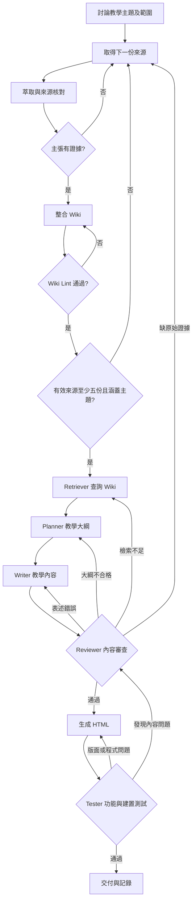

# Workflow Graph V1 — 教學簡報產生與驗證流程

> **規劃基準（尚未執行結果）**。本檔案依據 `AGENTS.md` v2.0 第 12 與 13 節建立，作為第一次執行作業的基準工作流程。
> 實際執行過程與每個節點的檢查結果應追加記錄於 `workflow/execution-log.md`。

## 1. 流程圖（Mermaid）

## 2. 節點定義與驗收條件

| 節點 | 輸入 | 輸出 | 驗收條件 |
|---|---|---|---|
| **Retriever** | 教學目標、`wiki/index.md`、概念及角色頁 | `evidence.md`：可用主張、Wiki 路徑、來源 ID、缺口 | 關鍵主張有可查證依據 |
| **Planner** | 學習目標、已核對證據 | `outline.md`：投影片順序、目的、引用 | 由淺入深，涵蓋所有目標 |
| **Writer** | 大綱、證據表 | `slide-content.json`：正文、例子、引用、小測驗 | 易讀，所有事實在 Wiki 中有依據 |
| **Reviewer** | Wiki、大綱、正文 | `review.md`：問題及修改建議 | 事實、來源、語言、難度與誤解檢查均通過 |
| **HTML Generator** | 已通過審查的 `slide-content.json` | Astro/HTML/CSS/JS 及可瀏覽簡報 | 版面、操作、引用及路徑正確 |
| **Tester** | 建置結果、原始內容 | `checks.md`：命令、測試與實際結果 | 通過規定驗收或清楚標示未驗證 |

## 3. 回饋決策與重試規則

| 錯誤類型 | 返回節點 | 修正重點 |
|---|---|---|
| 來源不可讀、來源缺失、版本衝突 | Find sources / Ingest | 補證據、記錄限制、重新整合 |
| Wiki schema、索引、關聯錯誤 | Integrate / Lint | 修正受影響 Wiki，保留來源 |
| 證據已在 Wiki 但未檢索到 | Retriever | 補查索引與相關頁 |
| 教學順序不當、目標未覆蓋 | Planner | 調整大綱後重寫受影響頁 |
| 知識表述、例子、引用或小測驗錯誤 | Writer / Reviewer | 只修正受影響內容，再審查 |
| HTML 溢出、鍵盤、樣式、base path 或 build 錯誤 | HTML Generator / Tester | 局部修正程式並重測 |

### 重試與中斷限制
- **單一節點限制**：同一節點對同一問題最多自動修正 3 次。
- **整體回饋限制**：全次執行的錯誤回饋轉移上限建議 15 次。
- **Gate 狀態定義**：`PASS`、`FAIL`、`BLOCKED`、`NOT_RUN`。
- **中斷條件**：達到次數上限、持續缺少來源或環境不支援時，標記 `BLOCKED` 並交由使用者確認。
